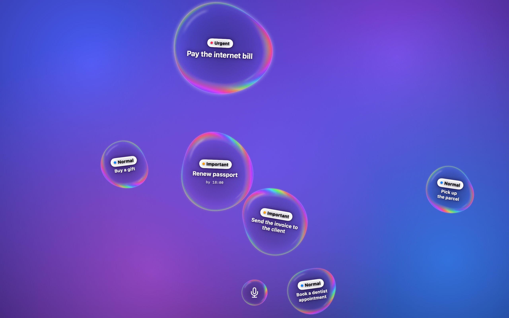
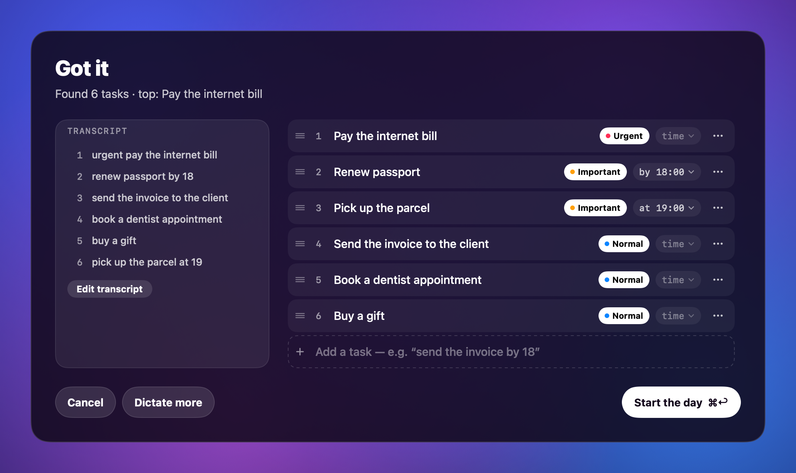
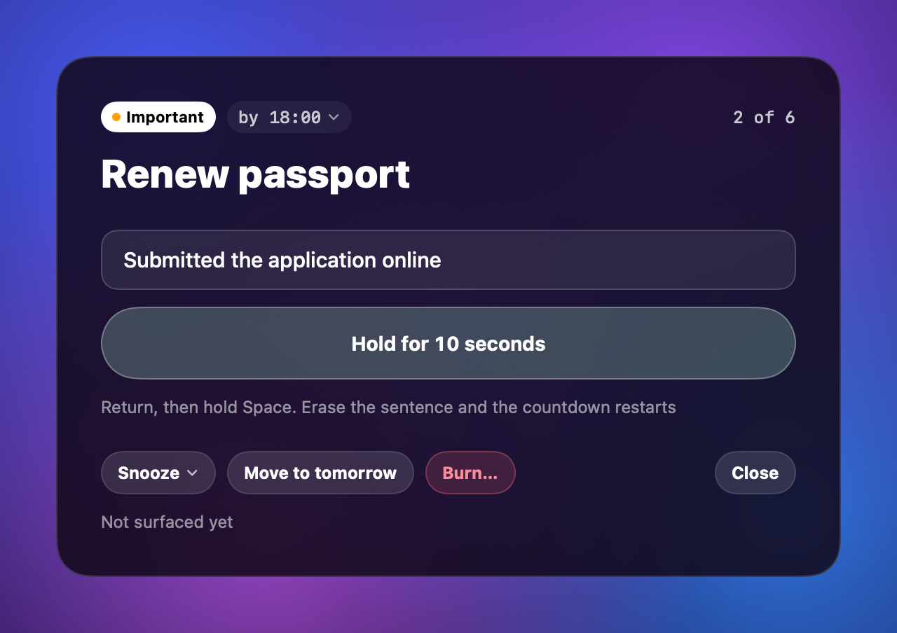

# Bubbles

*A macOS menu bar app that keeps your day's tasks on the desktop as soap bubbles. Dictate the day — speech is recognised on your Mac by the bundled Whisper, no internet needed — confirm the list, and the bubbles float behind your windows until each task is honestly done: one sentence about what you did, then hold the button for ten seconds. Claude or ChatGPT can sort the dictation with your own key; without a key it is a plain tracker. By default it never pops up or covers the screen. Swift/SwiftUI, macOS 26+, Apple Silicon, builds with the Command Line Tools only. MIT.*

Tasks in an ordinary reminder app are easy to swipe away and forget. Bubbles keeps them on the desktop itself: you dictate the day in the morning, the tasks become soap bubbles, and the important ones are bigger. The bubbles float under your windows and do not let go until the task is done.

The interface is in English. You can dictate in Russian or English; each task keeps the language you said it in.



## Features

- **Soap bubbles on the desktop.** Transparent, with an iridescent film and highlights. They float under the windows, collide with each other, and can be grabbed and thrown. Urgent ones are bigger. A click opens the card, a right click opens a quick menu: urgency, time, snooze, move to tomorrow, burn.
- **Dictation with built-in Whisper.** The microphone at the bottom of the desktop, or ⌥Space. Speech is recognised on your Mac (whisper.cpp and the large-v3-turbo model are inside the app), with no internet and no other software. Russian, English and mixed phrases. A pause in speech starts a new task. You can pick another engine instead: ChatGPT in the cloud, macOS system recognition, or the separate [Handy](https://github.com/cjpais/Handy) app.
- **Claude or ChatGPT with your own key, or a plain tracker.** With a key, the AI splits the dictation into tasks with deadlines and urgency. Without a key, every line becomes a task exactly as written.
- **"Got it" review.** Before the day starts you see the transcript and the tasks: fix the title, urgency and time, reorder, split, merge, delete. Nothing appears on the desktop until you press the start-the-day button.
- **Reminder ladder, background only by default.** Out of the box the bubbles never pop up and never cover anything. If you turn it on in the settings, the top task surfaces above your windows every N minutes, and before a deadline it takes over the screen. During screen sharing, a call or Focus mode the takeover waits.
- **Hold the button.** A task can only be closed honestly: one sentence about what you did, then hold the button (or the space bar) for 10 seconds. The hold time is configurable from 1 to 30 seconds.
- **Can't catch me.** A mode in which the bubbles run away from the mouse: they cannot be closed until the mode is turned off.
- Also: an "All tasks" window (⌘L), a day summary with a streak, move to tomorrow, "Hide bubbles" for an hour or until tomorrow, film tint, and a bubble shape from a circle to a crumbly blob.

<p>
  
  
</p>

## Installation

One command, for a person or an agent:

```sh
git clone https://github.com/blvgor/bubbles && cd bubbles && make install
```

`make install` downloads the whisper.cpp engine and the Whisper model (≈640 MB, checksums are verified), builds `Bubbles.app` and puts it in `~/Applications`. The first build takes a few minutes; later builds download nothing. Then open the app from Finder or with `open ~/Applications/Bubbles.app`; an icon appears in the menu bar.

Start the app only through Finder or `open`, not by running the binary from a terminal: otherwise macOS asks the terminal for microphone access and kills the process.

### Requirements

- macOS 26 or newer, Apple Silicon (arm64 builds only).
- Command Line Tools: `xcode-select --install`. Xcode is not needed.
- Internet access for the first build.
- About 2.5 GB of free space during the build. The installed app is ≈560 MB, almost all of it the model; you can delete the source folder after installing.

### For development

```sh
make check     # build and all tests (Swift Testing)
make app       # only build build/Bubbles.app
make run       # build and open
make vendor    # only download whisper.cpp and the model into Vendor/
```

`WHISPER_MODEL=0 make app` builds the app without the model (≈10 MB); the model is then downloaded with a button in the settings. `scripts/whisper-smoke.sh` checks the built-in Whisper on synthesized speech, without the app and without a microphone. For sandboxes where SwiftPM does not work, there are `make check-direct` and `make app DIRECT=1`.

## Permissions

Only the **microphone** is required: for the built-in Whisper and for cloud recognition. The rest is optional: "Speech Recognition" is asked for only in the macOS engine mode, and the Focus status is used so that the screen is not covered when you asked not to be disturbed. The app needs no access to the screen, files or wallpaper.

The build is signed ad-hoc, so after every rebuild macOS may ask for the permissions and for keychain access again.

## Privacy

Everything is stored and computed on your Mac. Tasks, streak and history are in `~/Library/Application Support/Bubbles/`, settings are in `UserDefaults`, and the Claude and ChatGPT keys are only in the keychain. By default the built-in Whisper recognises your voice: no audio leaves the Mac.

Only what you turned on yourself leaves the Mac, and only with your key: the dictation text goes to the chosen provider (Anthropic or OpenAI) for parsing and, in "ChatGPT (cloud)" mode, the audio of your phrases goes to OpenAI. Without a key there are no network requests, except the "Download model" button in a build without the model. There is no analytics or telemetry.

## Architecture

A Swift Package Manager package with no `.xcodeproj`, built with the Command Line Tools.

- `BubblesCore` holds the logic without AppKit and SwiftUI: tasks, storage and streak, the ladder, bubble physics, ranking, the "Got it" draft, splitting speech at pauses, and the Claude and ChatGPT clients. It is covered by Swift Testing tests.
- `Bubbles` is the menu bar app: transparent desktop windows, bubbles as Core Animation layers on a display link, the film drawn by the app itself, SwiftUI panels, dictation, the keychain.

More in [docs/architecture.md](docs/architecture.md); decisions and their reasons are in [docs/adr/](docs/adr/).

## Third-party components

They are not in the repository: `scripts/fetch-whisper.sh` downloads them into `Vendor/` during the build, and `make app` puts them into `Bubbles.app`.

| What | Source | License |
|---|---|---|
| whisper.cpp, `whisper.xcframework` (build b5454 = v1.9.5) | [ggml-org/whisper.cpp](https://github.com/ggml-org/whisper.cpp) | MIT, © The ggml authors |
| Whisper large-v3-turbo model, ggml q5_0 | [ggerganov/whisper.cpp on Hugging Face](https://huggingface.co/ggerganov/whisper.cpp), weights from [openai/whisper](https://github.com/openai/whisper) | MIT, © OpenAI |

The texts of their licenses are in [THIRD_PARTY_NOTICES.md](THIRD_PARTY_NOTICES.md).

## License

[MIT](LICENSE), © 2026 blvgor.
